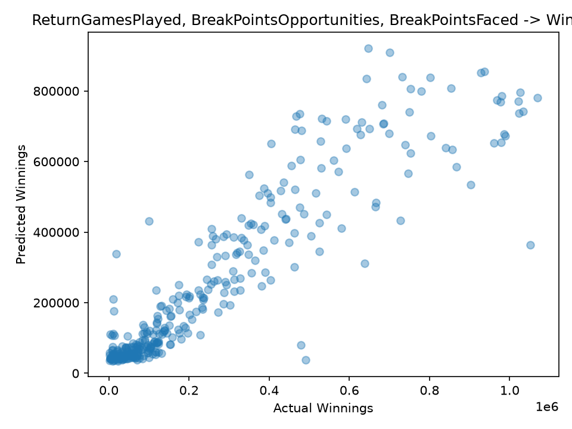

# Tennis Ace

Linear regression on ATP (Association of Tennis Professionals) data from 2009 to 2017, to find which playing habits best predict yearly earnings, wins and ranking.

## Project structure

```
tennis_ace_starting/
├── data/tennis_stats.csv      # ATP player-season statistics
├── src/tennis_ace.py          # analysis script
├── reports/figures/           # saved plots
├── requirements.txt
└── README.md
```

## Setup

```powershell
python -m venv .venv
.venv\Scripts\Activate.ps1      # macOS/Linux: source .venv/bin/activate
pip install -r requirements.txt
python src\tennis_ace.py        # macOS/Linux: python src/tennis_ace.py
```

The script prints R² scores to the terminal and saves plots to `reports/figures/`.

## Method

- Explored relationships between service and return statistics and the outcomes (Winnings, Wins, Ranking) using scatter plots.
- Split the data 80/20 into train and test sets (`random_state=6`).
- Fit scikit-learn `LinearRegression` models with one, two and multiple features.
- Scored each model by R² on the held-out test set (1,721 player-seasons in total).

## Results

| Model | Features | Outcome | Test R² |
|-------|----------|---------|---------|
| Single feature | ServiceGamesPlayed | Winnings | 0.828 |
| Single feature | ReturnGamesPlayed | Winnings | 0.828 |
| Single feature | Aces | Winnings | 0.582 |
| Single feature | TotalPointsWon | Winnings | 0.167 |
| Single feature | ServiceGamesPlayed | Wins | 0.848 |
| Single feature | BreakPointsOpportunities | Ranking | 0.112 |
| Two features | BreakPointsOpportunities, ReturnGamesPlayed | Winnings | 0.831 |
| Multiple features | ReturnGamesPlayed, BreakPointsOpportunities, BreakPointsFaced | Winnings | **0.834** |

### Best model: predicted vs actual Winnings



## Key takeaways

- The best model for Winnings used three features (`ReturnGamesPlayed`, `BreakPointsOpportunities`, `BreakPointsFaced`) and reached a test R² of 0.834.
- Adding features helped very little. The best single feature scored 0.828, and using all service and return features together (0.829) did no better. The extra features mostly carry the same information.
- Features like `ServiceGamesPlayed` and `ReturnGamesPlayed` predict Winnings well mostly because players who win more matches play more games. They reflect how deep a player goes in tournaments more than how well they play.
- Performance-style features were much weaker. `Aces` explained about 58% of the variance in Winnings and `TotalPointsWon` only about 17%.
- Ranking was poorly predicted (R² of 0.112 from `BreakPointsOpportunities`). Ranking is not linear in the stats: rank 1 is far better than rank 2, but rank 200 is barely different from rank 201, and lower rank numbers mean better players.
- Results come from a single train/test split, so small differences (for example 0.830 vs 0.834) are within noise. Cross-validation would give a more reliable comparison.

## Data and license

The dataset comes from Codecademy's Tennis Ace project (ATP data, 2009–2017) and is not covered by this repository's license. The code is released under the MIT License (see `LICENSE`).